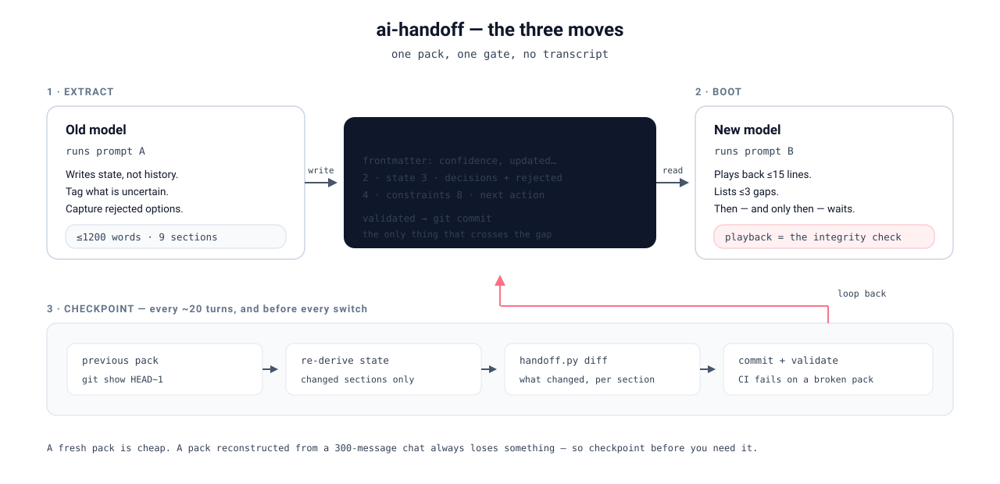
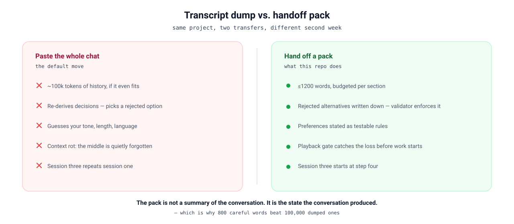

# ai-handoff

[](https://github.com/borodayeh/ai-handoff/actions/workflows/validate.yml)
[](LICENSE)
[](pyproject.toml)
[](pyproject.toml)

Move a project from one AI model to another without losing what matters. It's a skill that runs
the transfer itself, plus a validator that refuses to pass a pack which would lose information.

No dependencies, no API keys, no plugins. Python 3.9+ if you want the script, nothing at all if you
don't. Works with any model that can read text, including the ones you have no app for.

> **راهنمای فارسی: [docs/README.fa.md](docs/README.fa.md)**



### The whole thing in sixty seconds

You don't need the script to get value today. Three steps:

1. Ask the old model for a pack, using [prompt A](assets/prompts.md). It writes ~1200 words of
   state, not a summary of the chat.
2. Paste that pack into the new model with [prompt B](assets/prompts.md). It replies with a
   fifteen-line playback and up to three questions.
3. Correct the playback if it's wrong. Then say continue.

The script adds three things on top: it checks the pack before you send it, it diffs versions, and
it gives the repo a CI gate. Useful, not required.

```bash
python3 scripts/handoff.py new myproject --example   # a filled example to start from
```

**Contents:** [Why](#sound-familiar) · [Without an app](#does-it-work-without-an-app) ·
[Install](#install) · [How it works](#how-it-works) · [Walkthrough](#walkthrough) ·
[Commands](#commands) · [Publish to GitHub](#putting-it-on-github) · [Per-model notes](#using-it-with-specific-models) ·
[Validator](#what-the-validator-refuses) · [FAQ](#questions-people-actually-ask) ·
[Troubleshooting](#when-it-goes-wrong)

---

## Sound familiar?

You've been working with a model for three weeks. It knows your project, your tone, your rules, the
three approaches you tried and hated. Then you switch models, or the chat gets too long, and you
paste the whole history into a new window.

The new model reads it and promptly proposes the exact thing you rejected in week one.

Three things went missing, and none of them were written down anywhere:

- **What you rejected, and why.** This is the worst one, because it comes back as a confident
  suggestion. "Have you considered using LaTeX?" Yes. We did. It broke.
- **Your preferences.** Word count, tone, language, the way you want code presented. You taught
  those over dozens of corrections and never typed them out.
- **Where the work actually stands.** Not "we built a parser" but "the parser handles CSV but not
  quoted fields, and the counter double-counts if you kill the process."

Copying the transcript doesn't transfer any of this. It transfers the raw material and asks the new
model to redo the same derivation, this time buried in a hundred thousand tokens where the middle
gets forgotten. An 800-word state sheet beats the dump, because here the compression is the work.



---

## Does it work without an app?

Yes, and this is the main reason it's a folder of text files instead of a web service.

Nothing gets installed on the model's side. There's no OAuth, no marketplace listing, no "connect
your account". A handoff pack is a markdown file, and a boot prompt is a paragraph you paste. If the
model can read text, it can take a handoff.

| What the model can do | What you do | What still works |
|---|---|---|
| Files + git + shell (Claude Code, Cursor, local agents) | Point it at the repo | Everything: it pulls the pack, validates it, boots, and diffs versions on its own |
| Files only (Claude/ChatGPT/Gemini with attachments) | Attach the pack, paste the boot prompt | Everything except running the validator, which you run locally |
| No files, just a text box (many local models, some regional chat UIs) | Paste pack and prompt inline | Everything. The 1200-word budget exists partly so this case stays cheap |
| No tools at all | Paste pack and prompt inline | Same as above. Plain text is the whole interface |

The other direction works too. The model that writes the pack doesn't need file access either; it
just needs to see your conversation and follow the extraction prompt.

The only real limitation: a model with a very small context window can't hold the pack plus a long
task. Keep it near 800 words in that case, and cut the glossary and artifact sections first.

---

## Install

**Clone it.** This is the normal path:

```bash
git clone https://github.com/borodayeh/ai-handoff.git
cd ai-handoff
python3 -m unittest discover -s tests
```

You should see 34 tests pass. If you don't, something's off with your Python, not with the code.

```bash
make test        # the suite
make strict      # validate the example packs, warnings treated as failures
```

**Or download the ZIP** and unzip anywhere. There's no install step, and it runs from any directory.

**Or install the command** if you'd rather type `handoff` than a path:

```bash
pipx install .          # or: pip install --user .
handoff validate packs/myproject-pack.md
```

Nothing is published to PyPI on purpose: the script is meant to be read before it's trusted, and a
folder of text files is easier to audit than a wheel.

**Or install it as a skill** so the model finds it by itself:

| Where | What to do |
|---|---|
| Claude Code | Copy the folder to `~/.claude/skills/ai-handoff/` |
| Claude.ai or similar web UIs | Upload `SKILL.md` and `references/` into a project |
| Cursor / Windsurf | Paste `SKILL.md` into `.cursor/rules/` |
| Anything else | Give the model read access to this folder and tell it to start with `SKILL.md` |

The frontmatter in `SKILL.md` is what makes it discoverable. It triggers on model switches, context
limits, fresh chats, conversation exports, and the words handoff, migrate, port, checkpoint, resume.

---

## When this is overkill

- The chat is short. Two messages of context are easier to paste than to structure.
- The task is one-off. There is no state worth preserving after it ends.
- You're going to solve it in the same session anyway. Checkpoint first, hand off second.

Everything below assumes a project that has been running for a while and would cost real time to
rebuild from memory.

## How it works

Three moves. You'll usually only do the first and last.

| Move | Where it runs | What comes out |
|---|---|---|
| **Extract** | The old model | `<slug>-pack.md`, 1200 words or less |
| **Boot** | The new model | A short playback of what it understood, then it waits for your go-ahead |
| **Checkpoint** | Every 20 turns or so | An updated pack, with a diff against the previous one |

The pack has nine sections, and each one earns its place by preventing a specific failure:

| § | Section | Prevents |
|---|---|---|
| 1 | Mission | The model optimising for the wrong goal |
| 2 | Current state | Building on things that don't exist yet |
| 3 | Decisions and rejected alternatives | The same argument happening twice |
| 4 | Constraints | Your preferences being guessed again |
| 5 | Glossary | The model inventing its own meanings |
| 6 | Artifacts | Stale copies of files that already exist |
| 7 | Open questions | Work stopping on something only you can decide |
| 8 | Next action | A new session that opens with "what would you like to work on?" |
| 9 | Transfer notes | Silent guessing when something is missing |

Field-level rules and the anti-patterns behind them are in
[`references/pack-schema.md`](references/pack-schema.md).

The important part is the boot step. Before touching anything, the new model restates what it
understood in fifteen lines and lists up to three things it would otherwise have to guess. A dropped
fact shows up there as a wrong line, while it's still cheap to fix, instead of as a wrong commit
three hours later.

---

## Walkthrough

### 1. Extract

```bash
python3 scripts/handoff.py new myproject --from-model "claude-sonnet"
```

On Windows that's `py scripts\handoff.py ...` or the same command under Git Bash, which is easier
for the rest of this guide.

That gives you `myproject-pack.md` with the nine headings and word budgets already in place. Fill it
in yourself, or let the old model do it:

```
You are being decommissioned. Another model will continue this project with zero access to our
conversation. Write a handoff pack that loses nothing that matters.

Output only the pack. This is a state document, not a transcript: don't summarise our conversation
in order and don't paste conversation content. 1200 words maximum. Tag anything uncertain as
[UNVERIFIED]. Capture what we rejected and why, because that is what transfers always lose. State
my implicit preferences as testable rules ("3 paragraphs max, no preamble", not "be concise").

Schema: 1 Mission (120 words) · 2 Current state (works / half-built / broken / do-not-redo) ·
3 Decisions table (decision | why | rejected alternative | locked?) · 4 Constraints · 5 Glossary ·
6 Artifacts (pointers only) · 7 Open questions (with a named decider) · 8 Next action ·
9 Transfer notes. Last line: "Least confident about: <one thing>."
```

All four prompts, including the checkpoint and delta ones, live in [`assets/prompts.md`](assets/prompts.md).

### 2. Validate

```bash
python3 scripts/handoff.py validate myproject-pack.md
```

```
554/1200 words · 6 decisions · confidence=medium · [UNVERIFIED]×0 [LOST]×0
VALID
```

If it fails, it's still a draft. The checks are listed [further down](#what-the-validator-refuses).

### 3. Commit it

```bash
git add myproject-pack.md
git commit -m "pack: myproject after week 2"
```

Now `git log` is your checkpoint history, and `handoff.py diff` will show you what changed between
any two versions.

### 4. Boot the new model

```
You are taking over a project from another model. Everything you need is in the pack below.

Step 1. Read the pack. Don't start work.
Step 2. Play back your understanding in 15 lines or fewer, in your own words: MISSION (1 line),
  STATE (2-3 lines), CONSTRAINTS (the 3 most likely to trip you up), NEXT (as your commitment).
Step 3. List up to 3 gaps, contradictions, or things you'd otherwise have to guess. If there are
  none, say "no gaps".
Step 4. Stop and wait for me to say continue.

Don't praise the pack. Treat "locked: yes" decisions as settled. Treat [UNVERIFIED] as hypotheses
to check before building on.

PACK:
<paste myproject-pack.md here>
```

Read that playback properly. Fifteen lines is short enough that a missing fact is obvious.

### 5. Checkpoint before you need it

Ask the current model:

```
Produce an updated pack from the current state, same schema. Diff against the previous version:
list changed sections under "CHANGES SINCE LAST PACK", then output only those sections.
```

Or compare two committed versions yourself:

```bash
python3 scripts/handoff.py diff <(git show HEAD~1:myproject-pack.md) myproject-pack.md -v
```

That `<(...)` trick is bash. On Windows, save the old version to a file first:

```bash
git show HEAD~1:myproject-pack.md > old-pack.md
python scripts\handoff.py diff old-pack.md myproject-pack.md -v
```

A fresh pack costs two minutes. Rebuilding one from a 300-message chat costs the details you can't
remember.

---

## Commands

```bash
python3 scripts/handoff.py new <slug> [--out DIR] [--force]   # scaffold a pack
python3 scripts/handoff.py validate <pack.md> [--json]        # gate; exits 1 on failure
python3 scripts/handoff.py status <pack.md>                   # word count per section
python3 scripts/handoff.py diff <old.md> <new.md> [-v]        # what changed, section by section
python3 -m unittest discover -s tests                         # the test suite
```

Everything is standard library, output is plain text, and `--json` exists so CI can use it.

---

## Putting it on GitHub

The folder you have is already the repository. Skill, schema, validator, tests, CI and docs are all
in it. Nothing needs generating first.

**Keep it private** if you plan to store project packs in it, since those contain project state.

### With the GitHub CLI

```bash
cd ai-handoff
git init
git add -A
git commit -m "ai-handoff skill v1.0"
gh repo create borodayeh/ai-handoff --private --source=. --push
```

### Without it

```bash
cd ai-handoff
git init && git add -A && git commit -m "ai-handoff skill v1.0"
git remote add origin git@github.com:borodayeh/ai-handoff.git
git branch -M main
git push -u origin main
```

### From the browser

Create a new repository at `github.com/borodayeh`, choose **uploading an existing file**, then drag
in the contents of the folder. Keep the directory structure, GitHub preserves paths on drop. If your
browser flattens folders, unzip `ai-handoff-skill.zip` locally and drag the resulting folder instead.

### Then, from any new chat

```
Handoff repo: https://github.com/borodayeh/ai-handoff
Read SKILL.md, then references/boot-protocol.md, then packs/myproject-pack.md. Run boot.
Don't start work until I say continue.
```

A model with git access clones or pulls by itself from there. One without git access gets the pack
pasted inline.

### The five-minute polish that makes it look finished

GitHub shows a repo before anyone reads a line of it. Settings worth touching:

| Setting | Value |
|---|---|
| Description | Move a project between AI models without losing decisions or context |
| Topics | `ai` `llm` `context` `prompt-engineering` `agent-skills` `handoff` `markdown` |
| Website | leave empty unless you write about it |
| Features | Issues on, Discussions off until someone asks, Wiki off |
| Releases | tag `v1.0.0` and paste the changelog section into the release notes |

```bash
git tag -a v1.0.0 -m "ai-handoff v1.0.0"
git push origin v1.0.0
```

The badges at the top of this file start working as soon as the workflow runs once on `main`, no
edit needed.

---

## Using it with specific models

| Model | How to run it | Worth knowing |
|---|---|---|
| **Claude (web/desktop)** | Upload `SKILL.md` and the pack into a project | Best with files attached |
| **Claude Code** | Install to `~/.claude/skills/ai-handoff/`, then say "checkpoint with ai-handoff" | It can run the validator itself |
| **ChatGPT** | Paste prompt A or B from `assets/prompts.md`, attach the pack | Skills don't auto-load, so the prompt does the work |
| **Gemini** | Attach the pack and paste the boot prompt | Long context is not a reason to send the transcript |
| **Cursor / Windsurf** | `SKILL.md` into rules, packs into `.ai/packs/` | Repo-native, so artifacts stay as pointers |
| **Local models (Ollama, LM Studio)** | Paste pack and prompt inline | Trim toward 800 words; small models lose detail |
| **Anything with no file access** | Paste inline, cut the glossary and artifact sections | See [`references/gotchas.md`](references/gotchas.md) |

---

## What the validator refuses

| Check | Result |
|---|---|
| A section is missing, or present but empty (write `none` instead) | fails |
| A template placeholder survived (`{{...}}`, `<PLACEHOLDER>`, `TODO`) | fails |
| A decision row has no rejected alternative | fails |
| `confidence` isn't `high`, `medium`, or `low` | fails |
| The next action isn't a concrete step | fails |
| `updated` isn't a real date, or is in the future | fails |
| The whole pack is under 150 words | fails |
| `confidence: high` while `[UNVERIFIED]` or `[LOST]` tags remain | warns |
| The pack is more than 180 days old | warns |
| A section is over budget, or the pack is over 1200 words | warns |
| A decision row is missing `why` or `locked?` | warns |
| An open question has no named decider | warns |
| A string that looks like an API key or private key appears anywhere | warns |

CI runs this on every `*-pack.md` with `--strict`, which turns the warnings into failures too. A
broken pack can't be committed quietly.

---

## Questions people actually ask

**Should I paste the whole conversation?**
No. That's the failure this exists to prevent. Pull out the state and send 1200 words.

**What if I've already lost the chat?**
Export it as JSON or HTML, hand it to a strong model with the extraction prompt, and explicitly
forbid a chronological summary. Otherwise a chronological summary is exactly what you'll get. Then
add your preferences by hand, because exports almost never contain the corrections you made.

**Does this work for code projects?**
Yes, with one rule: the pack points at the repo and never copies from it. Add a line to section 6
saying "read AGENTS.md or CLAUDE.md in the repo root before coding". Architecture notes belong in
the repo, since a duplicate in the pack goes stale within days.

**Two projects in one repo?**
Fine. One `*-pack.md` each. The kernel file is shared and versioned once.

**Why not a web app?**
Because the format has to settle first. Build the UI now and you'll spend a weekend on the wrong
abstraction. Do five real transfers with markdown, and the sections you keep editing by hand will
tell you what the app needs to do, if it needs to exist at all.

**How is this different from asking for a summary?**
A summary is for a human reading a story. A pack is a state document with mandatory rejected
alternatives, an explicit confidence level, and a gate. Nobody is embarrassed when a summary
misses something, which is why summaries keep missing the same things.

---

## When it goes wrong

| Symptom | Likely cause | Fix |
|---|---|---|
| The new model starts coding immediately | The boot prompt got skipped | Re-send it and say "playback first" |
| It proposes something you already rejected | Section 3 has no rejected alternative | Add it; the validator now enforces this |
| It asks questions the old chat answered | Sections 2 or 4 are thin | Patch with a delta, don't rewrite the pack |
| It replies in the wrong language | The pack is in the wrong language | Write the pack in the language you want answers in |
| Validate fails on `<...>` | Real CLI syntax sitting in prose | Put it in backticks, code spans are exempt |
| It mentions files but never quotes them | No file access | Inline the one or two artifacts that matter, and say you did |
| A loss turns up after work started | No checkpoint had been taken | Patch the pack so the fix persists, then continue |

More edge cases, including team handoffs and switching back to the old model, are in
[`references/gotchas.md`](references/gotchas.md).

---

## Layout

```
ai-handoff/
├── SKILL.md                    # the skill: triggers, rules, workflow
├── references/
│   ├── pack-schema.md          # sections, budgets, field rules, anti-patterns
│   ├── boot-protocol.md        # the playback gate and lossy-transfer recovery
│   ├── kernel.md               # Think-First Protocol v3, optional standing rules
│   └── gotchas.md              # exports, context limits, code repos, teams
├── assets/
│   ├── template.md             # blank pack
│   └── prompts.md              # extract, boot, checkpoint, delta
├── examples/
│   ├── example-pack.md         # filled English example, validates clean
│   └── example-pack.fa.md      # filled Persian example, validates clean
├── packs/                      # your project packs go here
├── scripts/handoff.py          # new, validate, status, diff
├── tests/                      # 34 tests, no dependencies
├── CHANGELOG.md  CONTRIBUTING.md  ROADMAP.md  SECURITY.md
├── pyproject.toml  Makefile  .gitattributes
├── docs/
│   ├── README.fa.md            # راهنمای فارسی
│   ├── flow.svg
│   └── why-pack.svg
└── .github/workflows/validate.yml
```

## If you're stuck, or want to argue with the design

- [ROADMAP.md](ROADMAP.md) lists what was deliberately not built, and the reason for each. If you're
  about to ask for a web app or a summarize button, that's where the answer already is.
- [CHANGELOG.md](CHANGELOG.md) for what changed.
- [CONTRIBUTING.md](CONTRIBUTING.md) if you want to send a change. The short version: bring a real
  transfer failure, not a theory.
- [SECURITY.md](SECURITY.md): packs contain project detail, they land in git, and a secret that gets
  committed stays in the history even after you delete it.
- [Issues](https://github.com/borodayeh/ai-handoff/issues) has a template for "something got lost in
  a transfer", which is the most useful report this project can get.

Maintained at **[github.com/borodayeh/ai-handoff](https://github.com/borodayeh/ai-handoff)**.
MIT licensed, see [LICENSE](LICENSE).
